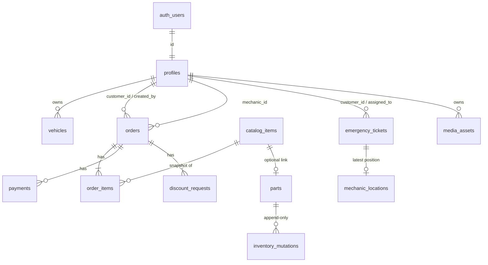

# ERD — PAS-One (Supabase PostgreSQL, schema `public`)

Standalone: `settings` (business parameters), `audit_logs` (append-only, written only by `_audit()`).
Write path: clients have **SELECT only** on orders/items/payments/emergency/inventory/discounts; every mutation is an RPC (`supabase/migrations/0003_rpc.sql`).
